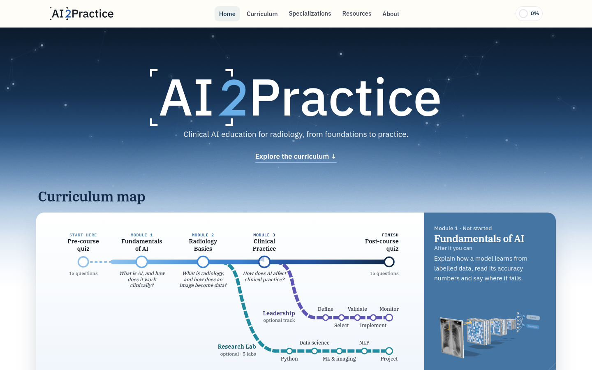
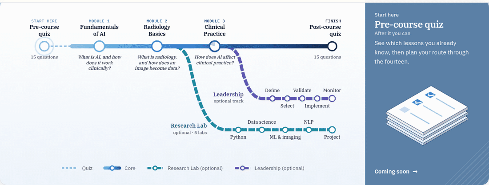
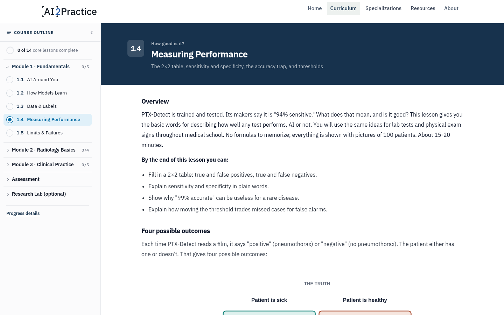
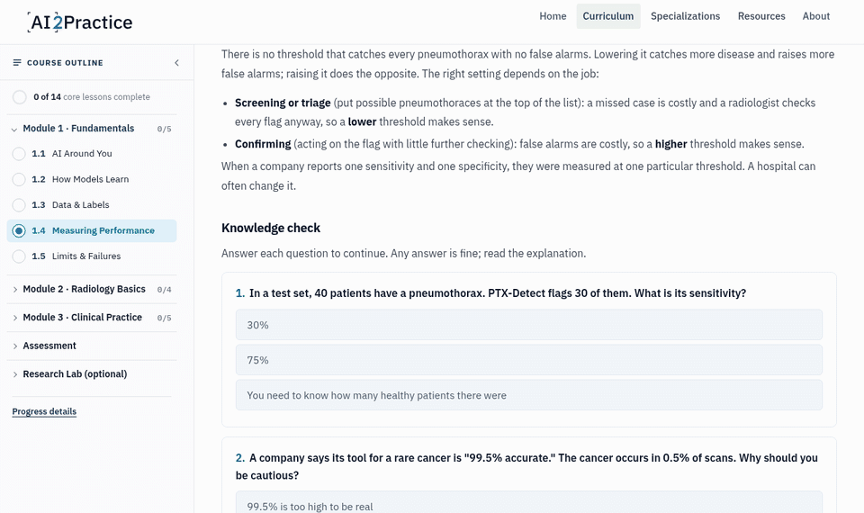
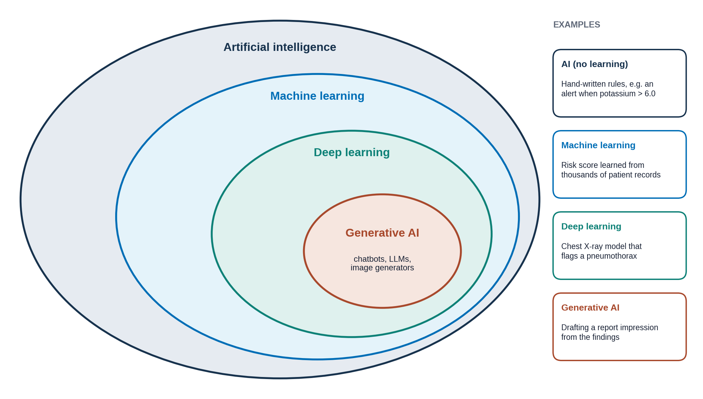
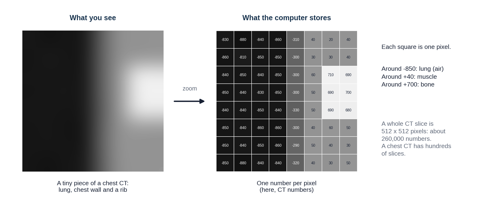
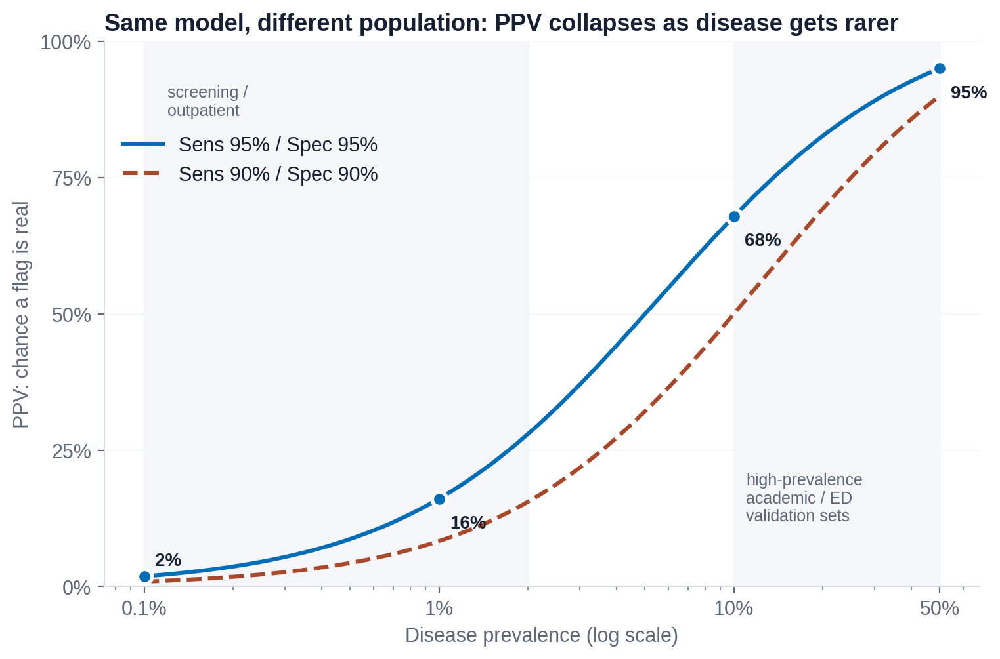

<p align="center">
  <picture>
    <source media="(prefers-color-scheme: dark)" srcset="images/ai2practice-logo-white.svg">
    <source media="(prefers-color-scheme: light)" srcset="images/ai2practice-logo.svg">
    
  </picture>
</p>

<h3 align="center">Clinical AI education for radiology, from foundations to practice.</h3>

<p align="center">
  A free, self-paced course that teaches medical trainees how AI works, how a radiology image becomes data,<br>
  and how to use AI tools in clinical work without losing the skills those tools depend on.
</p>

<p align="center">
  <a href="https://um-ihc-ca2i.github.io/ai2practice/"></a>
  <a href="#the-course"></a>
  <a href="#optional-tracks"></a>
</p>
<p align="center">
  
  
  
  
  
</p>

<p align="center">
  <a href="https://um-ihc-ca2i.github.io/ai2practice/"><strong>Visit the site</strong></a>
  &nbsp;&middot;&nbsp;
  <a href="https://um-ihc-ca2i.github.io/ai2practice/curriculum.html">Curriculum</a>
  &nbsp;&middot;&nbsp;
  <a href="https://um-ihc-ca2i.github.io/ai2practice/pages/educators.html">For educators</a>
  &nbsp;&middot;&nbsp;
  <a href="https://um-ihc-ca2i.github.io/ai2practice/tracker.html">AI Tool Tracker</a>
</p>

<br>

<p align="center">
  
</p>

## Why AI2Practice

AI is already reading alongside radiologists: triaging head CTs, flagging pulmonary nodules, drafting report impressions. Trainees now meet these tools before they have built the skills the tools are meant to support. Ke et al. call the risk **never-skilling**: when AI does a task from day one, the learner may never develop the judgment to do it alone, or to notice when the tool is wrong (*"AI-induced never-skilling in medical education"*, Nature Medicine, 2026).

AI2Practice is a response to that risk. It starts from zero, assumes no AI or programming background, and builds the understanding a trainee needs to use AI as a check on their own reasoning rather than a replacement for it.

> **Who it is for:** medical students, residents, fellows and the educators who teach them. No prior AI background is needed: every term is defined the first time it appears.

## The course

The course is one route with three core modules, a quiz at each end and two optional branches. On the home page the curriculum map is interactive: each stop opens a panel with what you will be able to do afterwards.

<p align="center">
  
</p>

<table>
  <tr>
    <th width="33%"><br>Fundamentals of AI</th>
    <th width="33%"><br>Radiology Basics</th>
    <th width="33%"><br>AI in Clinical Practice</th>
  </tr>
  <tr>
    <td align="center"><em>What is AI, and how does it work clinically?</em></td>
    <td align="center"><em>What is radiology, and how does an image become data?</em></td>
    <td align="center"><em>How does AI affect clinical practice?</em></td>
  </tr>
  <tr valign="top">
    <td>
      1.1 AI Around You<br>
      1.2 How Models Learn<br>
      1.3 Data &amp; Labels<br>
      1.4 Measuring Performance<br>
      1.5 Limits &amp; Failures
    </td>
    <td>
      2.1 What Radiology Is<br>
      2.2 Images as Data<br>
      2.3 The Journey of a Scan<br>
      2.4 Reading a Radiology Report
    </td>
    <td>
      3.1 AI in Radiology &amp; Medicine<br>
      3.2 Does It Work, and Is It Worth It?<br>
      3.3 Thinking With AI<br>
      3.4 Responsibility &amp; Patients<br>
      3.5 The Future of AI in Radiology
    </td>
  </tr>
</table>

**Start and finish.** A 15-question pre-course quiz shows where a learner begins (coming soon), and a matching post-course quiz shows what changed.

**A running case.** Modules 2 and 3 follow one patient, *Mr. Diaz*, from the scan request through image acquisition, the report and finally an AI tool's flag, so each new idea lands on a case the learner already knows.

## Inside a lesson

Each lesson takes 15 to 20 minutes and has the same rhythm: short readable sections, original figures, one light interactive and two or three knowledge checks.

<table>
  <tr valign="top">
    <td width="50%">
      
      <p><strong>Course outline and progress.</strong> A sidebar tracks finished lessons and saves your place. Signing in syncs progress across devices.</p>
    </td>
    <td width="50%">
      
      <p><strong>Ungraded knowledge checks.</strong> Learners must pick an answer before moving on, and any answer reveals the explanation. The point is to think, not to score.</p>
    </td>
  </tr>
</table>

**Interactives** include flip cards, drag-into-bins sorting, put-in-order steps, find-them-all image tasks and a prevalence slider that shows how a tool's positive predictive value falls as a disease gets rarer. Outside videos and tools open in a new tab.

### Figures drawn for the course

<table>
  <tr>
    <td width="33%"></td>
    <td width="33%"></td>
    <td width="33%"></td>
  </tr>
</table>

## Optional tracks

<table>
  <tr valign="top">
    <td width="50%">
      
      <p>Hands-on notebooks for learners who want to build, from a first Python script to a small research project.</p>
      <ol>
        <li>Getting started with Python &amp; GitHub</li>
        <li>Data science and AI evaluation</li>
        <li>Machine learning &amp; image processing</li>
        <li>Advanced image AI &amp; NLP <sub>(in development)</sub></li>
        <li>Mini research project <sub>(in development)</sub></li>
      </ol>
    </td>
    <td width="50%">
      
      <p>For people who will choose and run AI tools in a department: follow one tool from need to monitoring.</p>
      <ol>
        <li>Define the need</li>
        <li>Select &amp; procure</li>
        <li>Validate locally</li>
        <li>Implement</li>
        <li>Monitor &amp; govern</li>
      </ol>
      <p><sub>Overview available now; lessons planned.</sub></p>
    </td>
  </tr>
</table>

## Resources

| | |
|---|---|
| **AI Tool Tracker** | A searchable view of FDA-cleared AI devices, refreshed automatically by a GitHub workflow. |
| **AI2Practice Brief** | Short editorial notes on clinically relevant AI news: what changed, why it matters, how it connects to practice. |
| **For Educators** | Pick lessons and the quiz, then share the plan with a class as a single link. |

## Team

<table>
  <tr>
    <td align="center" width="50%">
      <br>
      <strong>Shinjer Li</strong><br>
      <sub>Co-lead<br>Eastern Virginia Medical School at Old Dominion University</sub>
    </td>
    <td align="center" width="50%">
      <br>
      <strong>Florence Doo, MD, MA, CIIP</strong><br>
      <sub>Co-lead<br>University of Maryland Institute for Health Computing</sub>
    </td>
  </tr>
</table>

**Contributors**

<table>
  <tr valign="top">
    <td align="center" width="25%">
      <br>
      <strong>Katherine Andriole, PhD</strong><br>
      <sub>Contributor<br>UCLA David Geffen School of Medicine</sub>
    </td>
    <td align="center" width="25%">
      <br>
      <strong>Peter Chang, MD</strong><br>
      <sub>Contributor<br>University of California, Irvine</sub>
    </td>
    <td align="center" width="25%">
      <br>
      <strong>Lars Grimm, MD, MHS</strong><br>
      <sub>Contributor<br>Duke University</sub>
    </td>
    <td align="center" width="25%">
      <br>
      <strong>Marta Heilbrun, MD</strong><br>
      <sub>Contributor<br>Intermountain Health</sub>
    </td>
  </tr>
  <tr valign="top">
    <td align="center" width="25%">
      <br>
      <strong>Elizabeth Krupinski, PhD</strong><br>
      <sub>Contributor<br>Emory University</sub>
    </td>
    <td align="center" width="25%">
      <br>
      <strong>Michail Klontzas, MD, PhD</strong><br>
      <sub>Contributor<br>University of Crete School of Medicine</sub>
    </td>
    <td align="center" width="25%">
      <br>
      <strong>Raisa Amiruddin, MBBS</strong><br>
      <sub>Contributor<br>MetroWest Medical Center, Massachusetts</sub>
    </td>
    <td align="center" width="25%">
      <br>
      <strong>Nadja Kadom, MD</strong><br>
      <sub>Advisor &middot; RRA representative<br>Emory University / Children's Healthcare of Atlanta</sub>
    </td>
  </tr>
</table>

<p>
  
  &nbsp;&nbsp;
  
</p>

An initiative of the **AAR / RRA Committee on Data Science &amp; AI**. Clinical content is reviewed by the project committee.

## Repository

<details>
<summary><strong>Repository structure</strong></summary>

```text
index.html            Home: hero and the interactive curriculum map
curriculum.html       The whole course on one page
assessment.html       Post-course quiz
tracker.html          AI Tool Tracker (FDA device data)
about.html            Team and project background
modules/              The three core module overviews
pages/                Research Lab, Leadership, For Educators, AI2Practice Brief
lessons/              Lessons (mN-N.html) and Research Labs (research-N.html)
  assets/             Lesson CSS/JS: layout, knowledge checks, interactives, per-module styles
  images/             Lesson figures (m1/, m2/, m3/)
assets/
  css/                site.css + theme.css (section pages), lesson-layout.css (lesson pages),
                      home.css, curriculum.css, progress.css, tracker styles
  js/                 site.js / shared.js (header, footer), progress.js (lesson registry,
                      progress, outline, account menu), auth.js + firebase-config.js (sign-in),
                      figures3d.js (home map figures), assessment, checkpoint, slideshow
images/               Logos, team photos, README media (readme/)
data/                 FDA AI device data, refreshed by .github/workflows/update-fda-ai-data.yml
scripts/              Data refresh and slide export scripts
downloads/            FDA device list slide
notebooks/            Research Lab notebooks and datasets
```

</details>

<details>
<summary><strong>Build status</strong></summary>

| Part | Status |
|---|---|
| Module 1, Fundamentals of AI (5 lessons) | Built |
| Module 2, Radiology Basics (4 lessons) | Built |
| Module 3, AI in Clinical Practice (5 lessons) | Built |
| Post-course quiz | Built |
| Pre-course quiz | Coming soon |
| Research Lab 1-3 | Built |
| Research Lab 4-5 | In development |
| Leadership | Overview built; lessons planned |

</details>

<br>

<p align="center">
  <sub>Framing: Ke et al., "AI-induced never-skilling in medical education," <em>Nature Medicine</em>, 2026.</sub>
</p>
